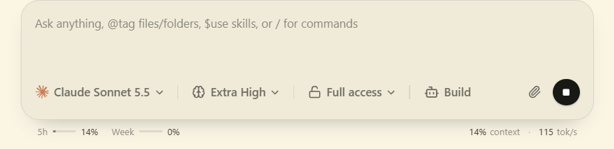
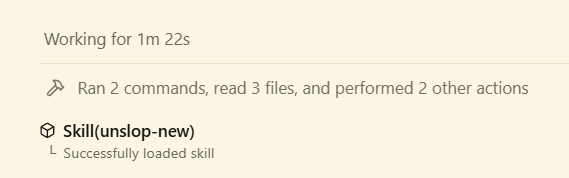

# t3code-customize for Windows

A Windows port of [btsouth/t3code-customize](https://github.com/btsouth/t3code-customize). It adds a stats bar under the T3 Code composer and rebuilds your copy of T3 Code Nightly after every update. Unofficial, not affiliated with T3 Tools.

The README in the repo root is btsouth's Linux README. It stays unchanged so his updates merge without conflicts. This page and [WINDOWS.md](https://github.com/MarvinFS/t3code-customize-windows/blob/main/WINDOWS.md) are the Windows docs.

## What you get

- Usage meters for your 5 hour and weekly limits, from the limits T3 already gets from your providers.
- Context used in the thread. Hover it for the window size, the auto-compaction threshold and a Compact now button.
- Tokens per second for the last response, with turn time and token details on hover. Claude rates are measured from the stream and Codex rates are labeled approximate.
- Cache rate for the last turn.
- Each Claude skill load as its own timeline row, shown like the Claude Code CLI does: `Skill(name)` with its arguments and a status line ("Loading skill", "Successfully loaded skill" or "Failed to load skill"). Stock T3 Code folds it into the "Used N tools" group, where it opens as raw JSON.
- A fix for Stop on a settled thread: it now clears the Monitor roster of the provider thread it interrupted, so the Monitor's Stop button works and the Provider error goes away.

The stats line under the composer: 5 hour and weekly usage on the left, context and tokens per second on the right.



A skill load in the timeline: `Skill(name)` with its status line below.



Everything else is stock T3 Code, including T3 Connect and the mobile app.

## Patches

| Patch | Content | Origin |
|---|---|---|
| 0001 | Stats for Nerds: response throughput and the composer stats line | btsouth |
| 0002 | Usage limits: background polling, reset-aware merging and fetch-time ordering | btsouth |
| 0003 | Compaction settings and a stats Compact action | btsouth |
| 0004 | Stop clears the Monitor roster of the interrupted provider thread | this repo |
| 0005 | Each Claude skill load as its own timeline row | this repo |

When a nightly moves the code a patch touches, the patches are ported here and `patches/base.txt` records the upstream commit they apply to.

## Install

You need T3 Code Nightly installed for the current user, Python 3.12 or newer, git, and Node 24 or newer with pnpm on the PATH.

```powershell
git clone https://github.com/MarvinFS/t3code-customize-windows C:\code\t3code-customize-windows
python C:\code\t3code-customize-windows\t3code-customize
python C:\code\t3code-customize-windows\t3code-customize schedule
```

The first run takes 10 to 20 minutes and about 6 GB of disk. Then open "T3 Code (Customized)" from the Start Menu and turn on Settings > General > Stats for nerds. `schedule` adds an hourly task that builds ahead for each downloaded nightly. See [WINDOWS.md](https://github.com/MarvinFS/t3code-customize-windows/blob/main/WINDOWS.md) for the update flow, the commands and how the Windows build differs from the Linux one.

## Install without building

A zip from `t3code-customize pack` holds the two patched files, `resources\app.asar` and `resources\server.asar`. It fits only the nightly in its file name, because the files are built from that nightly's exact upstream commit.

1. Quit T3 Code fully, including its tray icon.
2. Extract the zip into the T3 Code folder, the one that holds `T3 Code (Nightly).exe` (`%LOCALAPPDATA%\Programs\t3code` by default), and let it overwrite the two files.
3. Open T3 Code and turn on Settings > General > Stats for nerds.

Copy the two original files from `resources` somewhere first if you want a way back. A T3 Code update installs its own files again, so use the zip for the new nightly afterwards. Use this or the tool on a PC, not both. `pack` writes to `%LOCALAPPDATA%\t3code-customize\packs` and keeps the current and the previous zip. The tool keeps the current and the previous build.

## Checks before every build

The tool applies the patches to the exact upstream commit of your installed nightly, then runs what `checks.json` lists:

- 17 test files through `vp test run`.
- A typecheck of 8 packages through `tsc-rs --noEmit`. `tsc-rs` is Theo Browne's Rust port of the TypeScript 7 compiler. T3 Code already depends on it, and its own package scripts call it.

Four tests fail on Windows: two assert POSIX permission bits, one looks for a Unix path, and one upstream test times out. `checks.windows.json` lists each with its reason, and a build continues when only those fail. Any other failure stops the build and leaves your installed T3 Code alone.

## License

MIT, same as T3 Code.
